<p align="center">
  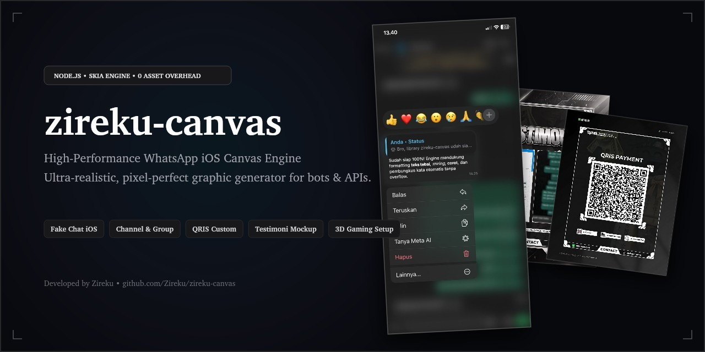
</p>

<h1 align="center">zireku-canvas</h1>

<p align="center">
  <b>High-performance, ultra-realistic WhatsApp iOS canvas & aesthetic graphic generator engine.</b><br>
  Built with hardware-accelerated Skia rendering for Node.js.
</p>

<p align="center">
  
  
  
  
  
</p>

### Overview

zireku-canvas adalah engine grafis berbasis Node.js yang dirancang khusus untuk menghasilkan gambar berkualitas tinggi, pixel-perfect, dan realistis untuk bot WhatsApp, aplikasi kasir, maupun media sosial.

Dapat digunakan dengan 3 cara:
1. **GitHub Dependency**: Install langsung ke project bot/aplikasi via `npm install github:Zireku/zireku-canvas`.
2. **Standalone REST API**: Jalankan langsung dengan `npm start` untuk melayani request HTTP dari bahasa pemrograman apa pun (Python, Go, PHP, dsb).
3. **Manual Module**: Clone repository dan import generator yang dibutuhkan.

### Fitur & Modul Canvas

<details open>
<summary><b>Tabel Daftar Fitur & Modul Canvas (11 Modul)</b></summary>
<br>

| Modul | Fungsi API | Deskripsi & Fitur Utama | Format Output | Hasil Render |
| :--- | :--- | :--- | :--- | :---: |
| **Fake Contact iOS (IQontact)** | `renderIQontact(options)` | Tampilan Info Kontak WhatsApp iOS lengkap: foto profil bulat, nama kontak auto-shrink, nomor telepon terformat, jam dinamis, dan tombol aksi suara/video/cari. | PNG (1080x2338) | [](docs/previews/preview-iqontact.jpg) |
| **Fake Chat iOS (IQC)** | `renderIQC(options)` | WhatsApp iOS incoming message bubble interaktif, dynamic bubble sizing/hugging, natural dark wallpaper, auto font scaling, collision-free timestamp. | PNG (1080x2338) | [](docs/previews/preview-iqc.jpg) |
| **Fake Quote Status iOS (IQS)** | `renderIQS(options)` | Quote chat balasan status WhatsApp iOS, dual-text (*quote* & *message*), dynamic downward expansion, timestamp presisi. | PNG (591x1280) | [](docs/previews/preview-iqs.jpg) |
| **Club Quotes Mockup** | `renderClubQuotes(options)` | Mockup papan kutipan club/lounge estetik dengan 2 pilihan background (Billboard Neon & Entrance Bar). | JPEG (1080x1350) | [](docs/previews/preview-clubquotes.jpg) |
| **Fake Channel iOS** | `renderFakeCH(options)` | Tampilan info WhatsApp Channel lengkap dengan foto profil bulat, jumlah pengikut terformat, dan kartu deskripsi adaptif. | PNG (591x1280) | [](docs/previews/preview-fakech.jpg) |
| **Fake Group iOS** | `renderFakeGC(options)` | Tampilan info WhatsApp Group dengan dukungan judul multiline, deskripsi dinamis, dan downward push. | PNG (591x1280) | [](docs/previews/preview-fakegc.jpg) |
| **Fake TikTok Video** | `renderFakeTTVT(options)` | Mockup UI TikTok realistis: avatar plus button, icon sidebar, like/comment/share counter, dan audio credit. | PNG (720x1600) | [](docs/previews/preview-fakettvt.jpg) |
| **QRIS Generator** | `renderBikinQRIS(options)` | Generator kartu pembayaran QRIS estetik dengan 5 pilihan template (Dark Modern, Anime Monokrom, Pink Notepad, March 7th, Compact WhatsApp). | PNG (1080x1350 / 736x736) | [](docs/previews/preview-bikinqris.jpg) |
| **Stok Akun 16:9** | `renderBikinStokAkun(options)` | Showcase akun game/sosmed 16:9, judul store 3D extrusion, kontak WA/IG, dan pill harga terformat otomatis. | JPEG (896x1200) | [](docs/previews/preview-bikinstokakun.jpg) |
| **Testimoni Transaksi** | `renderBikinTesti(options)` | Mockup 2 layar smartphone (Dark Tech & Clean Dual Phone) untuk memajang bukti transfer dan chat pelanggan. | PNG (1080x1350) | [](docs/previews/preview-bikintesti.jpg) |
| **Setup Gaming 3D** | `renderSetupGaming(options)` | Proyeksi gambar monitor gaming 3D trapezoid dengan koreksi perspektif non-linear dan efek pencahayaan ambient. | JPEG (1080x1920) | [](docs/previews/preview-setupgaming.jpg) |

</details>

<details>
<summary><b>Galeri Visual Hasil Render</b></summary>
<br>

<div align="center">

#### Fake Contact iOS (IQontact)
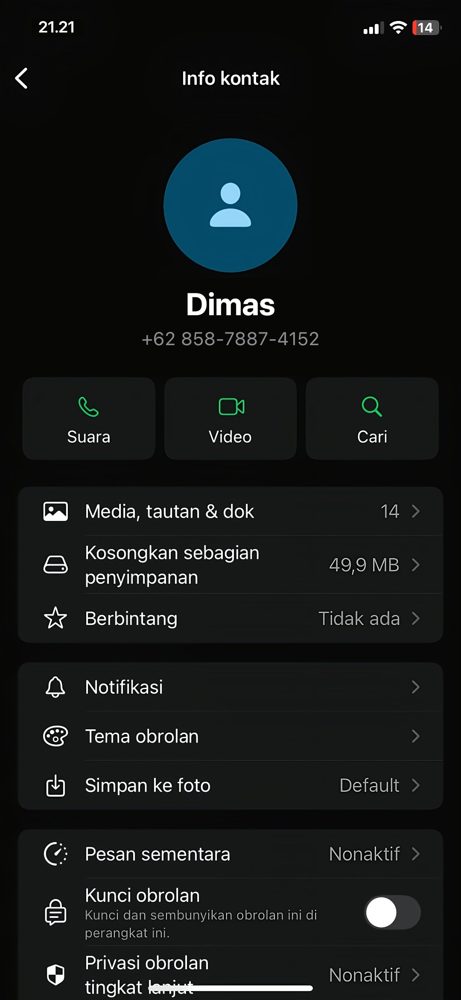

<br><br>

#### Fake Chat iOS Single Bubble (IQC) & Fake Quote Status iOS (IQS)
<p align="center">
  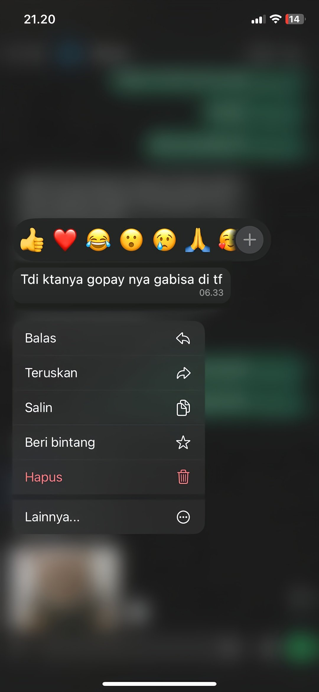
  &nbsp;&nbsp;&nbsp;&nbsp;
  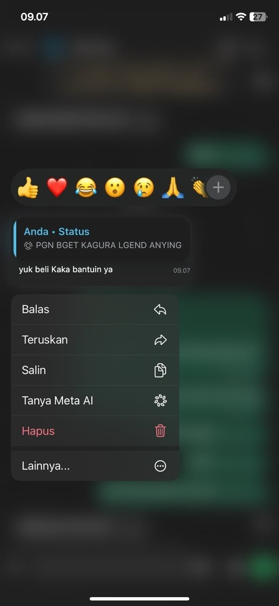
</p>

<br>

#### Club Quotes Mockup
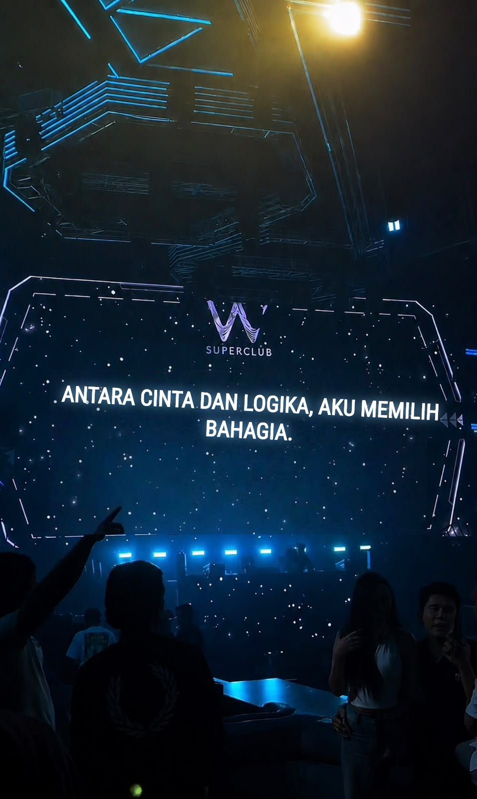

<br><br>

#### Fake Channel iOS & Fake Group iOS
<p align="center">
  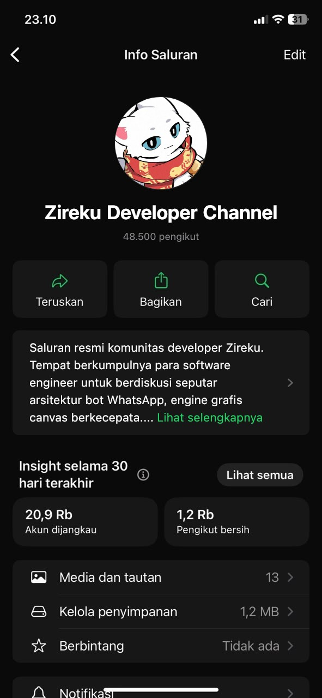
  &nbsp;&nbsp;&nbsp;&nbsp;
  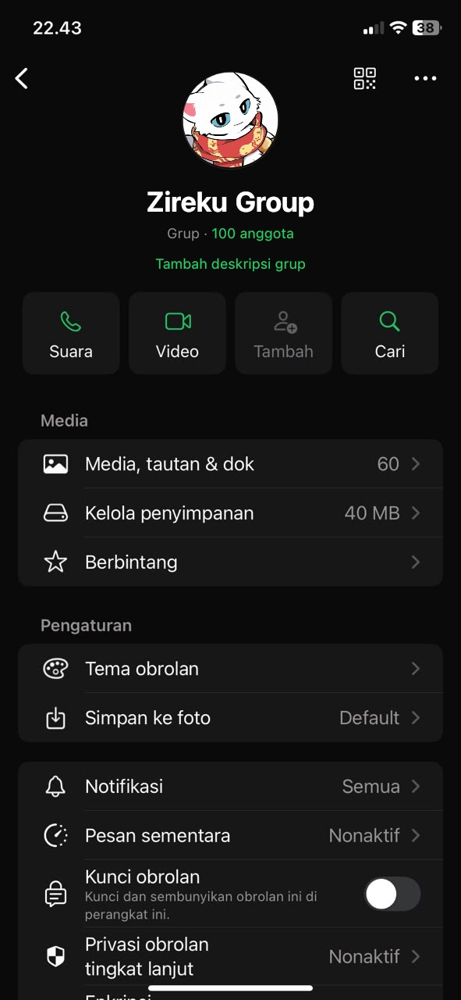
</p>

<br>

#### Fake TikTok Video Mockup
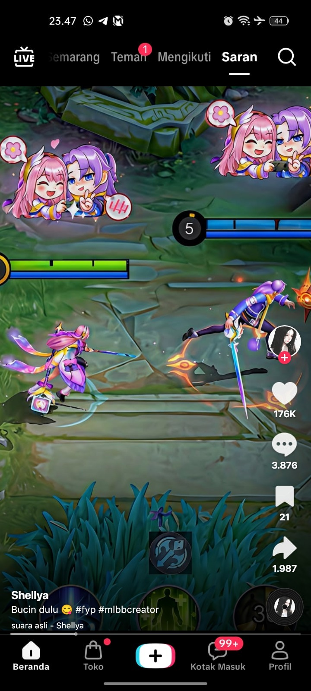

<br><br>

#### QRIS Generator & Stok Akun 16:9
<p align="center">
  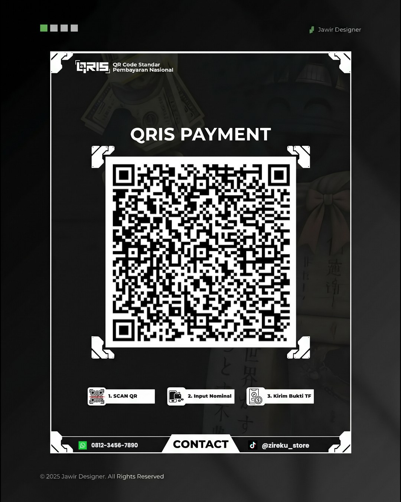
  &nbsp;&nbsp;&nbsp;&nbsp;
  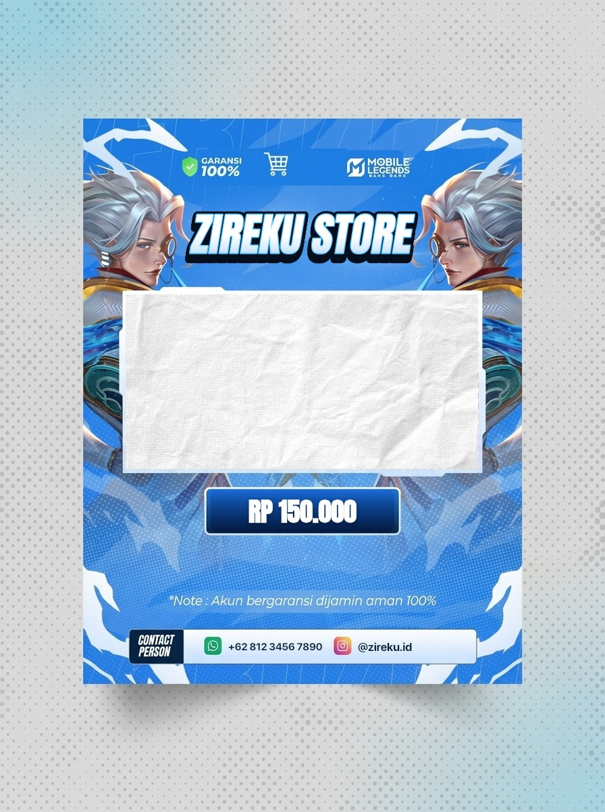
</p>

<br>

#### Testimoni Transaksi Dual Phone
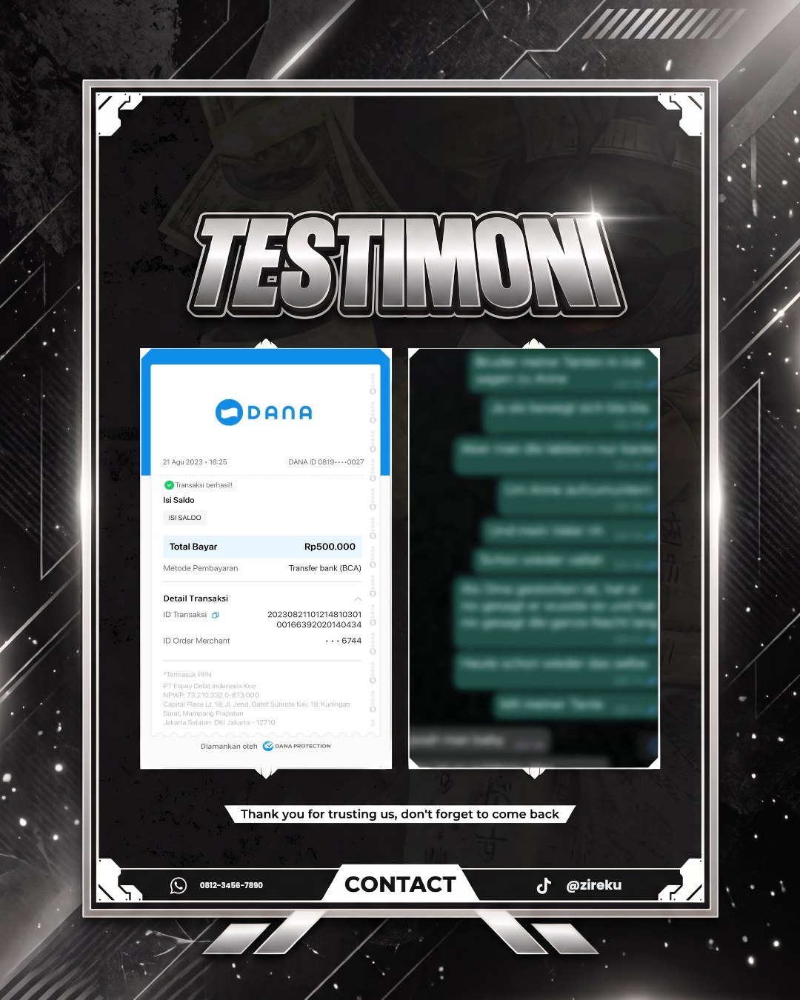

<br><br>

#### Setup Gaming 3D Perspective
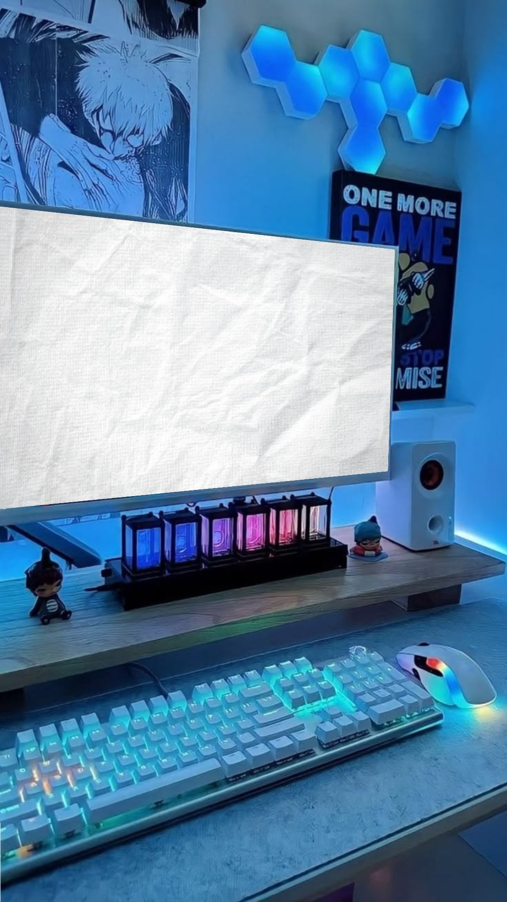

</div>

</details>

### Instalasi

#### Opsi 1: Pasang via GitHub Dependency
```bash
npm install github:Zireku/zireku-canvas
```

#### Opsi 2: Clone Manual
```bash
git clone https://github.com/Zireku/zireku-canvas.git
cd zireku-canvas
npm install
```

### Font Emoji iOS (Opsional)

Repository ini sudah menyertakan font Apple San Francisco (SF Pro) dan Noto Color Emoji bawaan. Bila ingin menggunakan font emoji resmi Apple iOS asli (AppleColorEmoji.ttf, ~110 MB), jalankan perintah:

```bash
npm run setup-emoji
```
Script otomatis ini akan mengunduh font langsung dari aset GitHub Releases resmi zireku-canvas.

### Contoh Penggunaan (API Caller)

> [!TIP]
> Klik judul modul di bawah ini untuk membuka dan melihat contoh kode implementasi.

<details open>
<summary><b>1. Fake WhatsApp iOS Contact Info (<code>renderIQontact</code>)</b></summary>
<br>

```javascript
import { renderIQontact } from 'zireku-canvas'
import fs from 'node:fs'

const buffer = await renderIQontact({
  name: 'Dimas',
  number: '+62 858-7887-4152',
  time: '21.21'
})

fs.writeFileSync('output-iqontact.png', buffer)
```

</details>

<details>
<summary><b>2. Fake WhatsApp iOS Single Bubble (<code>renderIQC</code>)</b></summary>
<br>

```javascript
import { renderIQC } from 'zireku-canvas'
import fs from 'node:fs'

const buffer = await renderIQC({
  text: 'Tdi ktanya gopay nya gabisa di tf',
  time: '06.33'
})

fs.writeFileSync('output-iqc.png', buffer)
```

</details>

<details>
<summary><b>3. Fake WhatsApp iOS Quote Status (<code>renderIQS</code>)</b></summary>
<br>

```javascript
import { renderIQS } from 'zireku-canvas'
import fs from 'node:fs'

const buffer = await renderIQS({
  quote: 'PGN BGET KAGURA LGEND ANYING',
  message: 'yuk beli Kaka bantuin ya',
  time: '09.07'
})

fs.writeFileSync('output-iqs.png', buffer)
```

</details>

<details>
<summary><b>4. Club Quotes Mockup (<code>renderClubQuotes</code>)</b></summary>
<br>

```javascript
import { renderClubQuotes } from 'zireku-canvas'
import fs from 'node:fs'

const buffer = await renderClubQuotes({
  text: 'Antara cinta dan logika, aku memilih bahagia.',
  template: 1
})

fs.writeFileSync('output-clubquotes.jpg', buffer)
```

</details>

<details>
<summary><b>5. Fake Channel Info iOS (<code>renderFakeCH</code>)</b></summary>
<br>

```javascript
import { renderFakeCH } from 'zireku-canvas'
import fs from 'node:fs'

const buffer = await renderFakeCH({
  avatar: 'https://example.com/avatar.jpg',
  channelName: '*Zireku* Developer Channel',
  followers: '25.400',
  description: 'Saluran informasi seputar arsitektur bot WhatsApp dan engine canvas.'
})

fs.writeFileSync('output-channel.png', buffer)
```

</details>

<details>
<summary><b>6. Fake Group Info iOS (<code>renderFakeGC</code>)</b></summary>
<br>

```javascript
import { renderFakeGC } from 'zireku-canvas'
import fs from 'node:fs'

const buffer = await renderFakeGC({
  avatar: fs.readFileSync('./group-avatar.jpg'),
  groupName: 'Zireku Group',
  members: '1.024',
  description: 'Komunitas resmi Zireku untuk kolaborasi developer, riset teknologi canvas, dan automasi bot.'
})

fs.writeFileSync('output-group.png', buffer)
```

</details>

<details>
<summary><b>7. Fake TikTok Video Mockup (<code>renderFakeTTVT</code>)</b></summary>
<br>

```javascript
import { renderFakeTTVT } from 'zireku-canvas'
import fs from 'node:fs'

const buffer = await renderFakeTTVT({
  video: './video-thumbnail.jpg',
  avatar: './profile-pic.jpg',
  name: 'Zireku',
  caption: 'Review bot WhatsApp tercanggih #fyp #coding',
  likes: '176K',
  comments: '3.876',
  shares: '1.987'
})

fs.writeFileSync('output-fakettvt.png', buffer)
```

</details>

<details>
<summary><b>8. Generator QRIS Custom (<code>renderBikinQRIS</code>)</b></summary>
<br>

```javascript
import { renderBikinQRIS } from 'zireku-canvas'
import fs from 'node:fs'

const buffer = await renderBikinQRIS({
  qrisImage: './my-qris-code.png',
  number: '0812-3456-7890',
  name: '@zireku_store',
  template: 1
})

fs.writeFileSync('output-qris.png', buffer)
```

</details>

<details>
<summary><b>9. Showcase Stok Akun (<code>renderBikinStokAkun</code>)</b></summary>
<br>

```javascript
import { renderBikinStokAkun } from 'zireku-canvas'
import fs from 'node:fs'

const buffer = await renderBikinStokAkun({
  accountImage: './screenshot-game.jpg',
  store: 'ZIREKU STORE',
  price: '150000',
  number: '08123456789',
  sosmed: 'zireku_id'
})

fs.writeFileSync('output-stok.jpg', buffer)
```

</details>

<details>
<summary><b>10. Mockup Testimoni (<code>renderBikinTesti</code>)</b></summary>
<br>

```javascript
import { renderBikinTesti } from 'zireku-canvas'
import fs from 'node:fs'

const buffer = await renderBikinTesti({
  image1: './bukti-transfer.jpg',
  image2: './chat-pelanggan.jpg',
  number: '08123456789',
  name: '@zireku',
  template: 1
})

fs.writeFileSync('output-testi.png', buffer)
```

</details>

<details>
<summary><b>11. Showcase Setup Gaming 3D (<code>renderSetupGaming</code>)</b></summary>
<br>

```javascript
import { renderSetupGaming } from 'zireku-canvas'
import fs from 'node:fs'

const buffer = await renderSetupGaming({
  screenImage: './gameplay-screen.jpg'
})

fs.writeFileSync('output-gaming.jpg', buffer)
```

</details>

### Menjalankan Sebagai Standalone REST API

Anda dapat menjalankan zireku-canvas sebagai backend service mandiri:

```bash
npm start
```
Server REST API aktif di `http://localhost:3000`.

#### Contoh Panggilan HTTP (cURL)

**1. Fake Contact iOS (IQontact)**
```bash
curl -X POST http://localhost:3000/api/iqontact \
  -H "Content-Type: application/json" \
  -d '{
    "name": "Dimas",
    "number": "+62 858-7887-4152",
    "time": "21.21"
  }' \
  --output hasil-kontak.png
```

**2. Fake Chat iOS (IQC)**
```bash
curl -X POST http://localhost:3000/api/iqc \
  -H "Content-Type: application/json" \
  -d '{
    "text": "Tdi ktanya gopay nya gabisa di tf",
    "time": "06.33"
  }' \
  --output hasil-iqc.png
```

**3. Fake Quote Status iOS (IQS)**
```bash
curl -X POST http://localhost:3000/api/iqs \
  -H "Content-Type: application/json" \
  -d '{
    "quote": "Halo bro",
    "message": "Pesan dari REST API *berhasil* dibuat!",
    "time": "10.00"
  }' \
  --output hasil-iqs.png
```

### Lisensi

Distributed under the MIT License. See `LICENSE` for more information.

Developed by [Zireku](https://github.com/Zireku).
